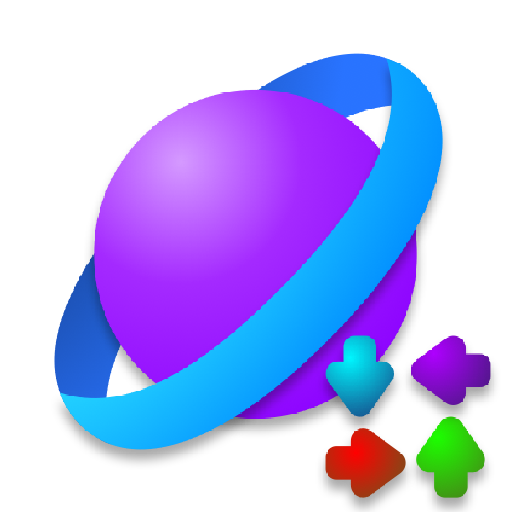
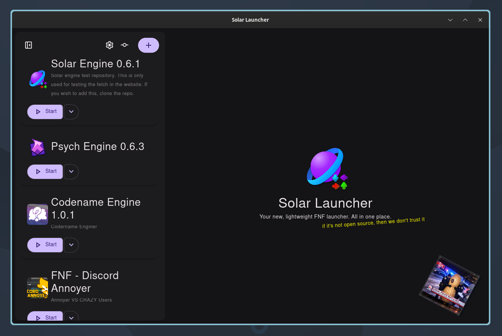
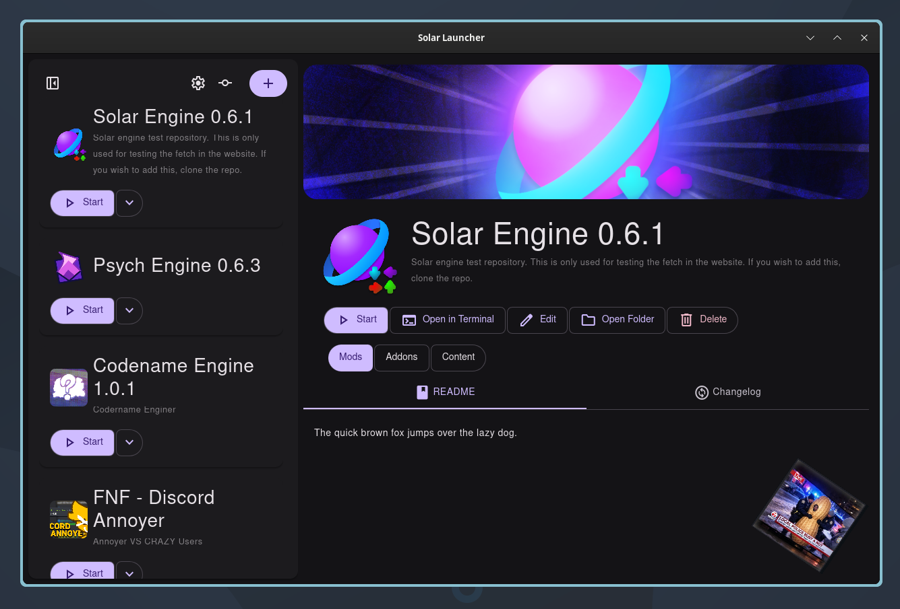
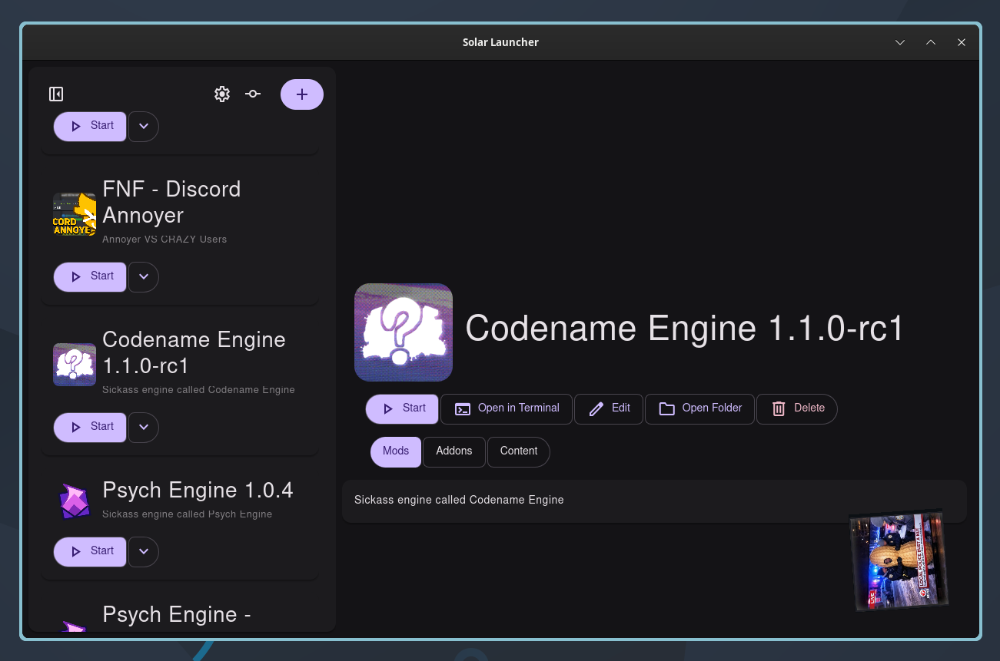
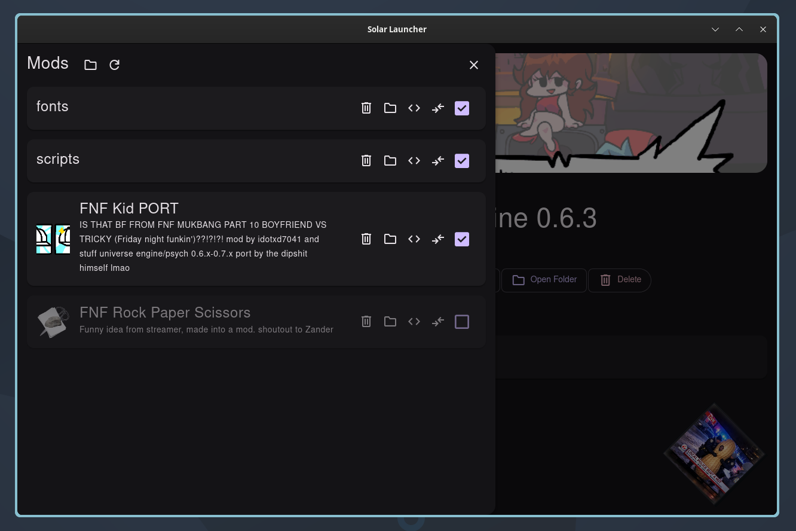
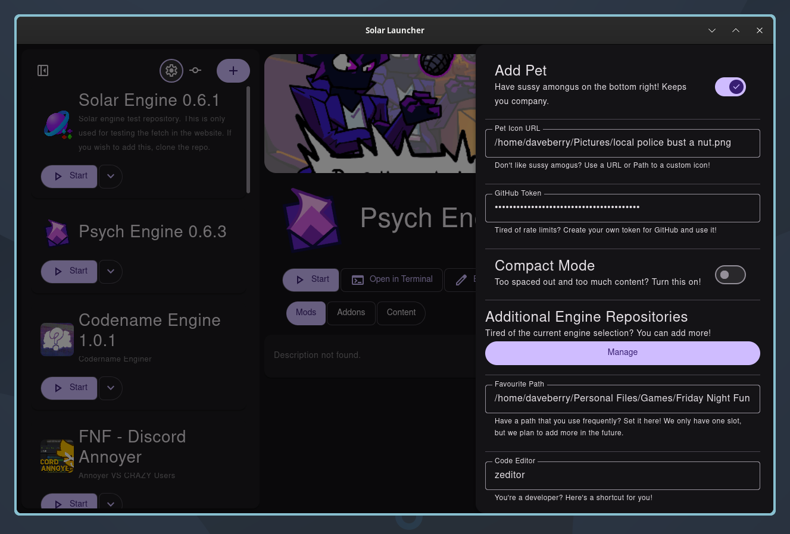
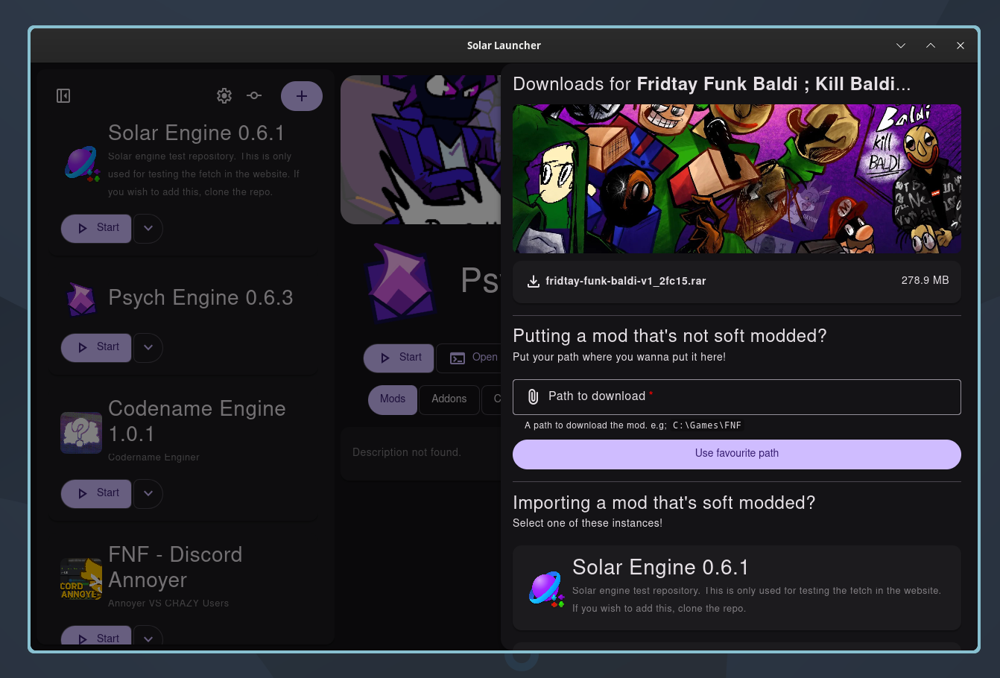
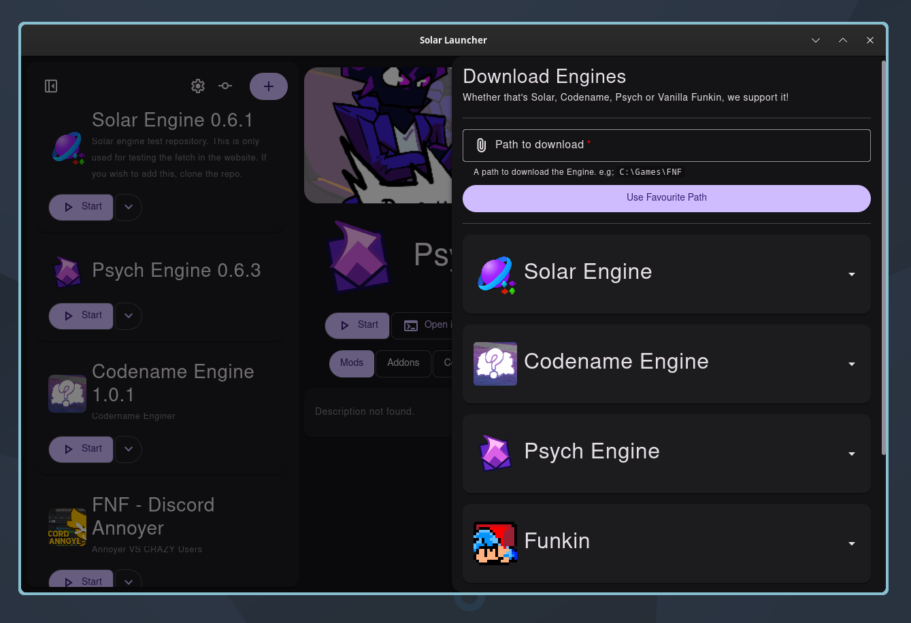
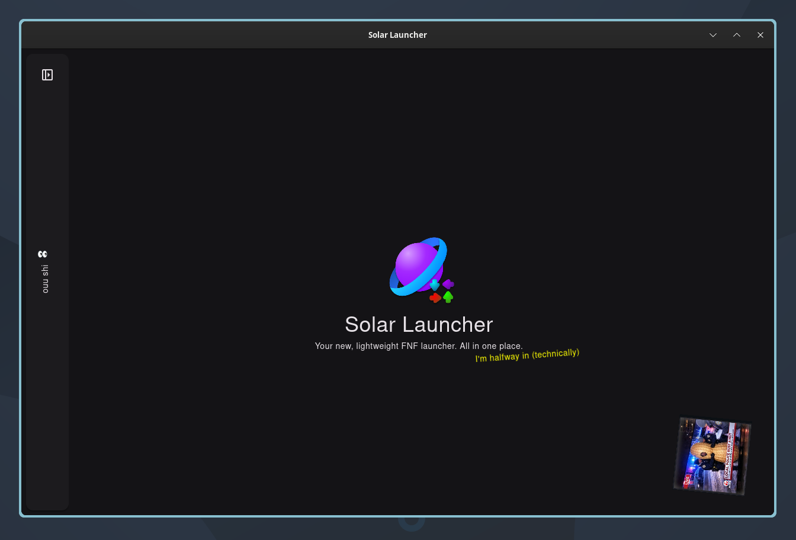

    
    <h1>Solar Launcher</h1>
    
        The launcher made for <b>developers</b>, and <b>normies</b>.  
        A fork of <a href="https://github.com/daveberrys/appshortsies">AppShortsies</a> made for launching FNF and non-FNF executable.  
        Available for <b>Windows</b>, <b>macOS</b>, and <b>Linux</b>.
        </https://github.com/Team-SolarEngine/solar-lanucher/wikispan>    
    
    
    

<h1>Previews</h1>

> These screenshots may be outdated. But nontheless, still the same interface.

<table align="center">
    <tr>
        <td style="width: 50%;">
            
            Empty Screen
        </td>
        <td style="width: 50%;">
            
            Main Content with banner, README and Changelog
        </td>
    </tr>
    <tr>
        <td style="width: 50%;">
            
            Main Content without banner, README and Changelog
        </td>
        <td style="width: 50%;">
            
            Mods section to toggle, delete, open folder, transfer, or open code editor
        </td>
    </tr>
    <tr>
        <td style="width: 50%;">
            
            Settings menu
        </td>
        <td style="width: 50%;">
            
            Gamebanana deeplink intergration
        </td>
    </tr>
    <tr>
        <td style="width: 50%;">
            
            Download engines inside the launcher
        </td>
        <td style="width: 50%;">
            
            Minimal, empty screen with sidebar closed
        </td>
    </tr>
</table>

<h1>Development Phase</h1>

Check out our [discord server](https://discord.gg/RaHmP5fgyA) for our development updates. Every commit or every development phase will be there, (almost) every time we make a change. Want to see the kanban board? [The link is here](https://github.com/orgs/Team-SolarEngine/projects/3/views/2)!

<h1>Downloads</h1>

You can get the **latest stable version** of Solar Launcher [here](https://github.com/Team-SolarEngine/solar-lanucher/releases). We recommend you to download the latest stable version.

If you want **nightly**, here's the link for each platform.

- [solarlauncher-macos-latest-aarch64-apple-darwin](https://nightly.link/Team-SolarEngine/solar-lanucher/workflows/build.yaml/main/solarlauncher-macos-latest-aarch64-apple-darwin.zip)
- [solarlauncher-macos-latest-x86_64-apple-darwin](https://nightly.link/Team-SolarEngine/solar-lanucher/workflows/build.yaml/main/solarlauncher-macos-latest-x86_64-apple-darwin.zip)
- [solarlauncher-ubuntu-latest-x86_64-unknown-linux-gnu](https://nightly.link/Team-SolarEngine/solar-lanucher/workflows/build.yaml/main/solarlauncher-ubuntu-latest-x86_64-unknown-linux-gnu.zip)
- [solarlauncher-windows-latest-x86_64-pc-windows-msvc](https://nightly.link/Team-SolarEngine/solar-lanucher/workflows/build.yaml/main/solarlauncher-windows-latest-x86_64-pc-windows-msvc.zip)

<h1>Features</h1>

<h2>Drag n' drop</h2>

Drag and drop mods. Either that's from a non-engine or a engine. Select if you want to pick a folder or select one of the instance you have.

<h2>Supports any executable</h2>

Literally supports any executables. This gives you flexibility for... something I guess? We don't have any advantages on this, other than running for bottles or wine in Linux.

<h2>Desktop Cross Platform</h2>

This is probably obvious, but we support desktop cross platform for <u>Windows</u>, <u>Linux</u>, and <u>macOS</u>. Sadly, we do not plan to make Android and iOS.

<h2>Deep Links</h2>

Solar Launcher supports deeplinks, that means, you can install mods and whatnot directly to the launcher easily! To call it, just do `solar-launch://gb-mods/{gamebanana-game-id}`. We directly support GameBanana.

Wanna try it out? [Click here](solar-launch://gb-mods/618481) - [Use the website instead](https://team-solarengine.github.io/solar-lanucher/). Github doesn't allow deep links.

<h2>In-App Engine Downloading</h2>

Leaving the Launcher just to get a specific engine takes too long. We've made it where you can download Solar, Codename, Psych, Funkin, and more (if you decide to add more via settings) directly in the launcher!

<h2>Mods Section</h2>

Deleting and disabling mods are now easier than ever! Just click on a checkbox to toggle, and click on the trash button to delete that mod forever. A folder button to open explorer, a transfer button to transfer the mod to another instance, and a editor button to open your editor in that mod!

<h1>Don't like Solar Launcher?</h1>

Use [WeekBox](https://gamebanana.com/tools/23228) instead! Support the team at WeekBox if you like it better than ours. Please don't go ramble about which one is better, just pick which one suits your need.

<h1>Don't know how to use?</h1>

We made a documentation to help you on how to use Solar Launcher to the fullest! [Here's the documentation! Read it throughly.](https://github.com/Team-SolarEngine/solar-lanucher/wiki)

<h1>LICENSE</h1>

This project is licensed under the MIT License. See the [LICENSE](LICENSE) file for details.
